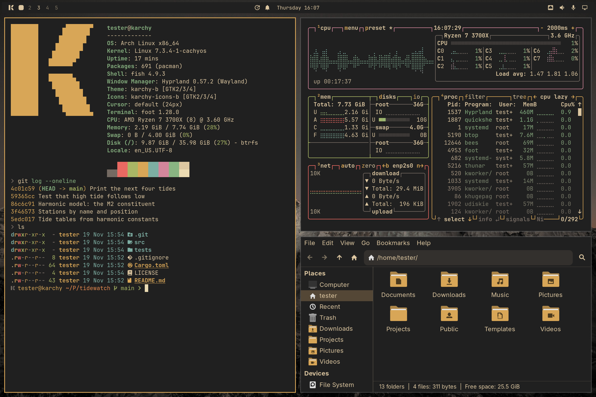
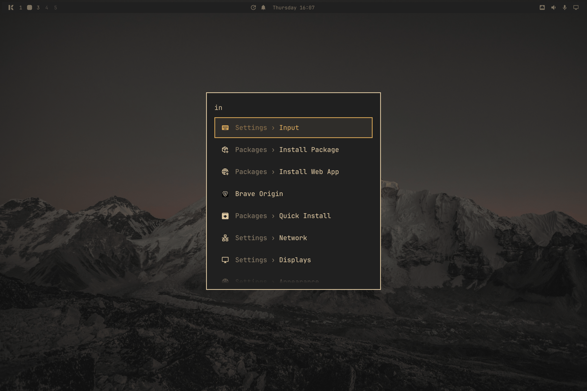
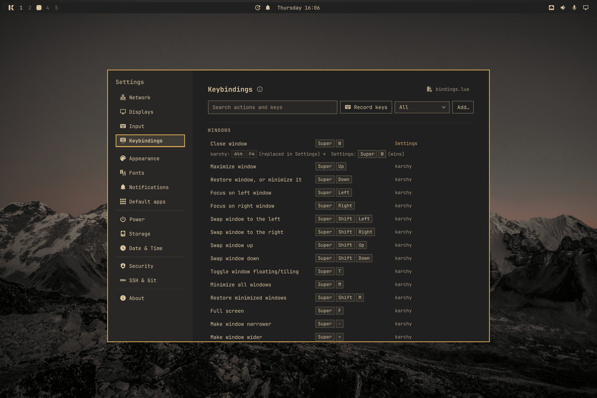

# karchy

**A minimal Arch Linux desktop on Hyprland, with one Settings window, signed updates and snapshots you can boot.**

  
  
  

karchy is a tiling desktop that works out of the box and stays out of the way.
The base install is small and fast. Everything is a pacman package, so the
system is updated, never reinstalled.

## What's in it

- **The desktop.** A bar, a menu that searches apps and settings with
  `Super` + `Space`, a notifications panel, and 24 themes that recolor
  everything at once.
- **Settings.** One window for network, displays, input, keybindings,
  appearance, power, storage, users and more. Your own config files still win.
- **Keybindings.** Every binding is listed with its keys, and you can change,
  add or reset them in Settings.
- **Quick install.** About 550 apps, fonts and optional features, installed
  from one window.
- **Updates.** One command or one button updates the whole system, with a
  snapshot before and after. Packages are signed, and you pick a stable, rc or
  nightly channel.
- **The system.** btrfs with snapshots you can boot from the boot menu. Disk
  encryption and a firewall are on by default, and Secure Boot is supported.
- **The installer.** A short form, a clear summary of what gets erased, and the
  right drivers for laptops and NVIDIA GPUs.
- **Agent skills.** AI coding agents learn how karchy works, so they can help
  you customize or troubleshoot it.

## Get it

Download the ISO from [releases](https://github.com/Nulifyer/karchy/releases),
write it to a USB stick and boot it. The installer starts by itself.
[Installing karchy](docs/installing.md) has the details.

## Docs

- [Installing](docs/installing.md)
- [Recovery](docs/recovery.md)
- [Components](docs/components.md)
- [Menu](docs/menu.md)
- [Keybindings](docs/keybindings.md)
- [Maintenance](docs/maintenance.md)
- [Architecture](docs/architecture.md)

## License

[MIT](LICENSE)
