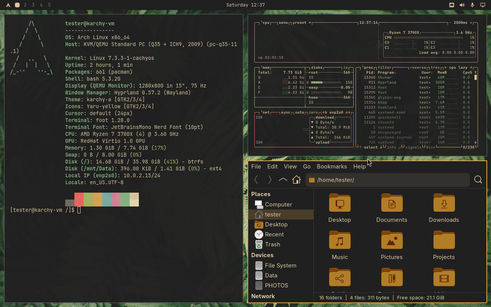

<div align="center">

# karchy


**A fast, good-looking Arch desktop that just works, and stays small.**

[](https://github.com/nulifyer/karchy/actions/workflows/release.yml)
[](https://github.com/nulifyer/karchy/releases/latest)
[](LICENSE)


</div>



karchy turns a fresh Arch install into a complete Hyprland desktop in about three
minutes: a polished bar and menu, a real Settings window, themes that recolor
every app at once, and updates you can trust. Everything you need works out of
the box; nothing you didn't ask for is installed.

## Features

| | Feature | What you get |
| :-: | --- | --- |
| 🪟 | Hyprland desktop | A Quickshell bar, app menu, notifications, lock screen and OSD, with tiling, scrolling or floating workspaces and Windows-style window keys. |
| ⚙️ | Settings | Displays, input, network, appearance, default apps, power and optional features, without editing a config file. Your own files always win. |
| 🎨 | One theme, every app | 24 themes; one switch recolors the shell, terminal, GTK and Qt apps, VS Code, micro, Brave, btop and the fish prompt, live. |
| 🔄 | Updates you can trust | One click or `karchy update` updates everything, with snapshots before and after. Signed packages, on the stable, rc or nightly channel. |
| 📸 | Snapshots | btrfs and snapper, with every snapshot bootable from the boot menu. |
| 🔒 | Secure by default | Full-disk encryption, Secure Boot set up for you, a firewall, fingerprint unlock on laptops, and a keyring that opens at login. |
| 💾 | Disks and NAS | Internal drives mounted like Windows does; keep a network share mounted from the menu. |
| 📡 | Sharing | LocalSend that only opens its port on networks you trust. |
| 🖥️ | Made for your hardware | Laptops, NVIDIA GPUs and VMs are detected at install and get what they need. |
| 🤖 | Ready for AI agents | Claude Code, Codex and other coding agents get skills that explain this system: how to change it safely, find a fault, and work with the features you installed. |
| ⚡ | CachyOS kernel | CachyOS's optimized kernel and packages on top of Arch. |

## Install

Boot the [Arch Linux ISO](https://archlinux.org/download/) in UEFI mode,
connect to the network, then:

```bash
pacman -Sy --noconfirm git
git clone https://github.com/nulifyer/karchy.git
karchy/install/karchy-install
```

Answer a short form (disk, username, one password, timezone, release channel),
and the rest is automatic. To turn on Secure Boot, put your firmware in Setup
Mode first. See [installing karchy](docs/installing.md) for details and
unattended installs.

## Try it

| Keys | What they do |
| --- | --- |
| `Super` + `Space` | Menu and app search |
| `Super` + `Return` | Terminal |
| `Super` + `E` | Files |
| `Super` + `K` | Every keybinding |
| `Super` + `Escape` | Lock, sleep, restart, shut down |

```bash
karchy update            # update karchy and the whole system
karchy channel           # see or change your release channel
karchy-settings          # open Settings
```

## Guides

- [Install karchy](docs/installing.md): the installer, Secure Boot, unattended installs and testing in a VM.
- [What's included](docs/components.md): every component and why it's there.
- [Keybindings](docs/keybindings.md) and [the menu](docs/menu.md).
- [How it's built](docs/architecture.md) and [how packages are made and released](packaging/README.md).

karchy started from [Omarchy](https://github.com/basecamp/omarchy)'s desktop
and owes it the shell, the theme system and much of its look.
[MIT licensed](LICENSE).
