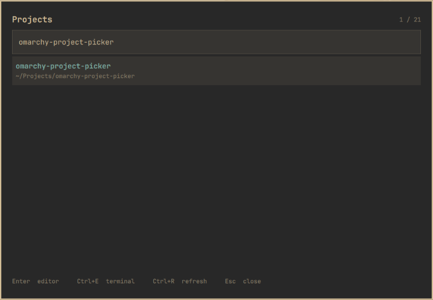

# Project picker

A Quickshell overlay for the karchy shell: find projects across your home
folder and open them in an editor or a terminal. It needs Python 3; the
default editor is VS Code, and terminals open through `xdg-terminal-exec`.



It is one of karchy's add-ons (`addons/project-picker` in karchy's
repository), built and released with karchy as the `karchy-project-picker`
package. The package installs the overlay into `/usr/share/karchy/plugins`
and its Ctrl+Alt+P binding into `/usr/share/karchy/hypr.d`, so the binding
exists only while the package is installed.

## Install

Quick install › karchy › Project picker, or
`sudo pacman -S karchy-project-picker`. The shell loads it as soon as the
package is installed; `karchy plugin disable karchy.project-picker` switches it
off without removing it.

## Develop

Change the files under `addons/project-picker` and build the package with
`packaging/build karchy-project-picker`. Tests: `python3 -m unittest
discover addons/project-picker/tests` and `node
addons/project-picker/tests/search.test.cjs`.

## Use

- Ctrl+Alt+P opens or closes the picker.
- Type to match project names or paths. Separate terms can match different
  parts of the path. Matching favors exact names, prefixes, word boundaries,
  and consecutive characters. This is a path-aware fuzzy matcher, not an
  exact implementation of fzf's scoring or query operators.
- Up/Down or Ctrl+P/Ctrl+N selects a project. Page Up/Down moves seven results.
- Enter opens the selected project in the editor. Clicking a result does the same.
- Ctrl+E opens a terminal in the selected project.
- Ctrl+R refreshes the list. Escape or clicking outside closes the picker.
- **New project** is the last row: Up from the first result reaches it, and
  it is the only row when nothing matches. Enter on it, or Ctrl+Shift+N from
  anywhere, asks for a name (the search text, if any). Enter then creates the
  folder in the projects root (`~/Projects`; created if missing) and opens it
  in the editor. Escape goes back to the list. The name must be one folder
  name, not `.`, `..` or a path, and the folder must not exist yet.

Every direct child directory of `~/Projects` appears first when there is no
search query, including hidden directories and symlinked projects. The home
scan finds outermost folders with `.git`, `.jj`, `.hg`, `.svn`, `.vscode`,
`.idea`, or `.devcontainer` entries. A `.git` file also qualifies, except a
linked worktree's, whose `.git` file points into another repository's
`.git/worktrees/`; secondary jj workspaces are skipped the same way, so the
copies that `git worktree add` and coding agents create don't crowd the list.
It skips dependency, cache, application-state (including `~/.t3`, `~/.claude`,
`~/.codex` and Wine prefixes), and build folders, plus any browser or Electron
app profile (a folder holding Chromium's `Local State` file), does not descend into
detected projects, and does not follow directory symlinks during the home scan.
Canonical paths are deduplicated while preserving the first alias.

Discovery runs outside the UI process. Results stream in, remain in memory
between openings, and refresh on each opening. A failed scan restores the
previous results. The picker shows the focused monitor and follows the active
menu theme. Paths are displayed as plain text and passed to launchers
as separate arguments, without shell evaluation. Launching checks that the
directory still exists. Application startup after handing off to `uwsm-app`
is managed by the desktop session.

## Theme integration

The picker uses the same `[menu]` surface roles as karchy's menu. Background, text, scrim, selected-row colors, and border
specifications come from `qs.Commons.Color` and `Border`. The plugin reads
colors as `Commons.Color` (imported `as Commons`): a bare `Color` resolves to
Qt Quick's own `Color` type, which has none of the shell's roles. Secondary text and errors use the shell's derived `secondaryText` and `status.error`
roles. Selected rows support
the menu's border widths, gradients, and per-side overrides. Secondary text
uses the menu foreground with reduced opacity, matching the built-in menu.

The search field is the shell's shared `qs.Ui.TextField`, so focus borders,
text selection, padding, and control fills follow the shell's `[style]`
settings. Fonts use `Style.font.menuFamily` and the shared size tokens. Input,
header, and row heights grow with their text. Theme changes update the bound
colors and geometry without restarting the plugin.

## Configure

Edit the plugin's entry inside the existing `plugins` array in
`~/.config/karchy/shell.json`. Preserve the surrounding configuration:

```json
{
  "id": "karchy.project-picker",
  "projectsRoot": "~/Projects",
  "editor": ["code"]
}
```

`projectsRoot` is also where New project creates folders. It defaults to the shell process's `Z_PROJECTS_ROOT` environment
variable, or `~/Projects`. `editor` is an argument array, so
`["code", "--new-window"]` is valid. Use a graphical editor command or an
explicit terminal wrapper for a terminal editor. Settings reload on save.

Inspect discovery without opening the UI:

```sh
python3 projects.py scan --home "$HOME" --root "$HOME/Projects"
karchy-shell shell call karchy.project-picker status '{}'
```

The summon payload accepts an optional `query` string for opening a filtered
picker from another command. For example:

```sh
karchy-shell shell summon karchy.project-picker '{"query":"dotfiles"}'
```

## Validate

```sh
python3 -m unittest discover -s tests -p 'test_*.py'
node tests/search.test.cjs
```

Node is needed only for the search tests. Automated tests cover discovery,
symlinks, path transport, launch arguments, missing editors, and fuzzy ranking.
Popup focus, keyboard navigation, editor launch, terminal working directory,
repeated toggles, and theme changes need a karchy desktop: install the built
package and run `karchy restart shell`.

## Remove

Quick install › karchy › Project picker › Remove, or
`sudo pacman -R karchy-project-picker`. The overlay and the Ctrl+Alt+P
binding go with the package.

## License

MIT. See [LICENSE](LICENSE).
